# Full-wave verification of the anapole antenna

Numerical study that checks the theoretical report in the repository root with
exact field integrals and with NEC-2 (method of moments). It shows the field of
every element and of their sum, where the field is and where it is not, and
which of the feeding options of the report actually produces an anapole.

All numbers below are radiated power relative to the bare dipole carrying the
same current at its generator (0 dB), at 104.2 MHz.

| Model | Radiated power | Outcome |
|---|---|---|
| 0 – ideal currents, h = 29.8 mm | −38.0 dB | anapole, as in the report |
| 0 – ideal currents, h = 29.46 mm | −50.7 dB | floor set by higher multipoles |
| 0 – winding reversed | +6.0 dB | contributions add |
| 1 – NEC-2, 12 independent loops, equal feed currents | +4.8 … −20.1 dB | depends on where each loop is fed |
| 1 – NEC-2, 12 independent loops, current ratio tuned | −47.8 dB | anapole |
| 2 – NEC-2, everything in series, one generator | +22 … +28 dB | **not** an anapole |
| 3 – NEC-2, two generators, plain winding | −1.2 dB at best | not an anapole |
| 3 – NEC-2, two generators, 30 series capacitors, trimmed | −33.9 dB | anapole |

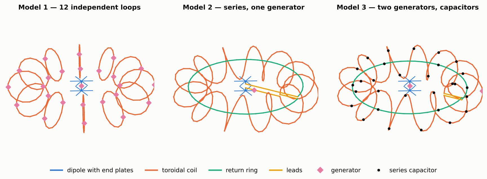

## What the simulations add to the report

1. **Return-wire radius.** The continuous toroidal winding has
   $m_z = I\pi(R^2 + a^2/2)$, not $I\pi R^2$: the projected area depends on the
   mean of $\rho^2$ along the wire. The return ring must have radius
   $\sqrt{R^2 + a^2/2} = 153.6$ mm. With a ring of radius $R = 150$ mm the
   suppression stops at −12.6 dB even with ideal currents.
2. **Uniform current inside each loop.** A loop is 0.30 m long (0.10 λ). Fed at
   one point, its current grows by up to 6.5 % on the opposite side. This gives
   the 12 loops a spurious electric dipole moment $\int J_z\,dV$ of up to
   −43.8 mm·A, larger than the central dipole (+28.2 mm·A). Two opposite feed
   points per loop remove most of it.
3. **The series connection does not work.** From plate to plate the wire is
   5.0 m (1.7 λ): the current is a standing wave with three nodes. Even at 3 MHz
   the current is not uniform, because the dipole is a ≈1 pF capacitor and the
   winding hanging from one of its arms is a much larger metal body.
4. **A version that works.** Dipole and winding fed by two generators; the
   winding is a closed circuit with two series capacitors per turn (17.4 pF)
   and six in the return ring (18.2 pF). The current becomes uniform within
   ±2 % in amplitude. After trimming the two capacitor values, the ring radius
   (152.7 mm) and the current ratio (0.766), NEC-2 gives −33.9 dB
   (−33.0 … −34.6 dB over four meshes).
5. **The price.** The trimmed antenna is a resonant circuit with Q ≈ 556:
   the −20 dB bandwidth is 290 kHz (report, ideal currents: ±5 MHz), capacitors
   must be matched to ≈0.5 %, and with copper and capacitor losses the radiation
   efficiency is 10⁻⁴ (−40 dB).

The anapole condition remains valid when written on the moments of the real
currents, $\int J_z\,dV + k^2 T_z = 0$ over the whole structure. The closed
form $h = k_0^2NAR/2$ holds for ideal currents only.

## Field of each element and of their sum

Ideal currents (model 0), 1 A in every element:

| Element | $\int J_z dV$ (mm·A) | $m_z$ (cm²·A) | $k^2T_z$ (mm·A) | $R_\text{rad}$ (mΩ) | Power (dB) |
|---|---|---|---|---|---|
| Dipole alone | +29.80 | 0 | 0 | 84.6 | 0.0 |
| Coil alone (12 loops) | 0 | 0 | −29.79 | 82.6 | −0.1 |
| Helix without return wire | 0 | +741.5 | −29.79 | 2514 | +14.7 |
| Return ring alone (radius R) | 0 | −706.8 | 0 | 2223 | +14.2 |
| Dipole + 12 loops | +29.80 | 0 | −29.79 | 0.0133 | −38.0 |
| Dipole + 12 loops, h = 29.46 mm | +29.46 | 0 | −29.79 | 0.0007 | −50.7 |
| Dipole + 12 reversed loops | +29.80 | 0 | +29.78 | 334.4 | +6.0 |
| Dipole + helix, no return wire | +29.80 | +741.5 | −29.79 | 2432 | +14.6 |
| Dipole + helix + return ring at R | +29.80 | +34.7 | −29.79 | 4.69 | −12.6 |
| Dipole + helix + return ring at 153.6 mm | +29.80 | 0.0 | −29.79 | 0.029 | −34.7 |

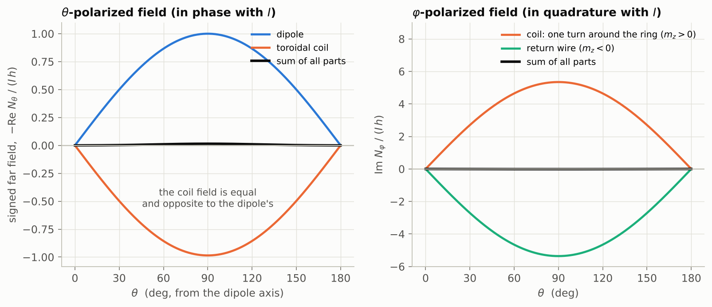
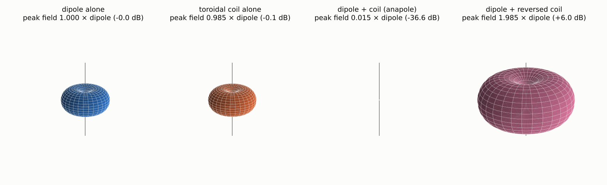

NEC-2 currents (model 3, trimmed), far field on the equator as effective
length, 1 A in the dipole and 0.766 A in the winding:

| Element | θ-polarized, in phase (mm) | φ-polarized, in quadrature (mm) |
|---|---|---|
| Dipole with plates | +28.16 | 0.00 |
| Toroidal winding | −23.66 | +120.42 |
| Return ring | −4.45 | −120.40 |
| Sum | +0.05 | +0.01 |

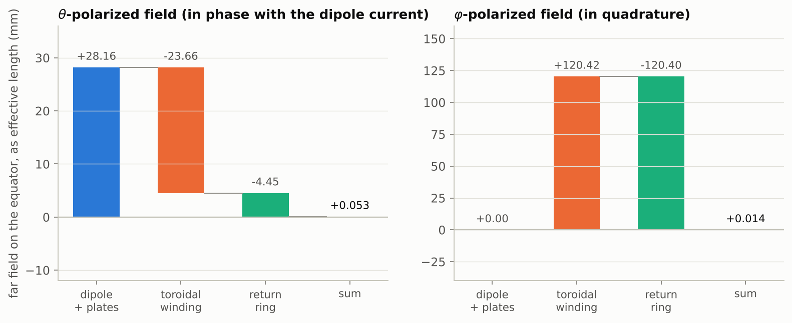
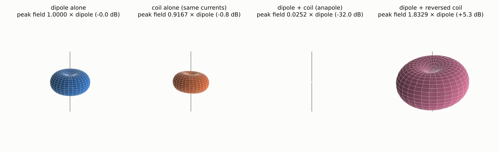

## Where the field is and where it is not

The field stays inside the sphere of radius $R + a = 19.7$ cm that encloses
the structure. Electric field of the anapole relative to the bare dipole, on
the equator:

| Distance | Ideal currents | NEC-2, model 3 |
|---|---|---|
| 0.10 m (inside) | +5.8 dB | — |
| 0.30 m | −7.8 dB | −10.5 dB |
| 0.50 m | −20.5 dB | −18.8 dB |
| 1.0 m | −42.6 dB | −31.9 dB |
| ≥ 3 m | −36 dB | −36 dB |

Inside, the fields are not small: more than 10 kV/m between the dipole plates
and about 10 A/m inside the torus, for 1 A. Just outside (20–50 cm) the
suppression is only 6–20 dB, because of the high-order multipoles of the 12
loops, which do not radiate but decay slowly enough to matter there.

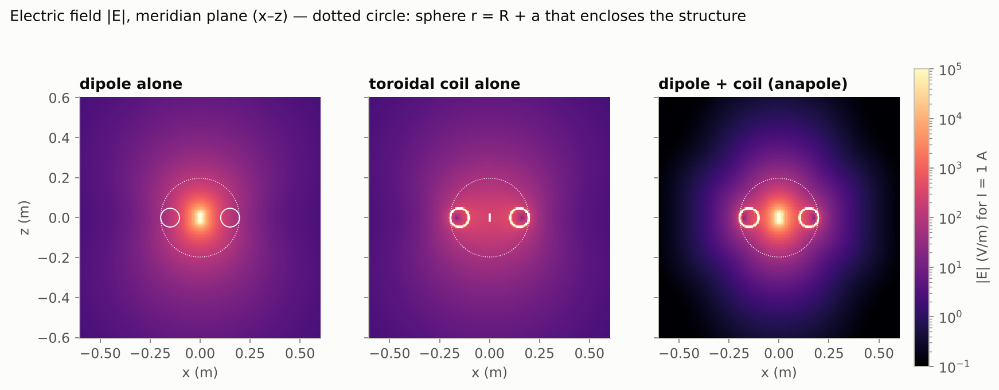
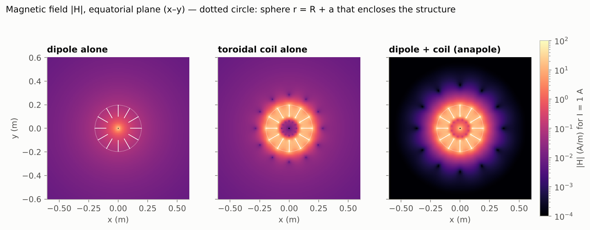
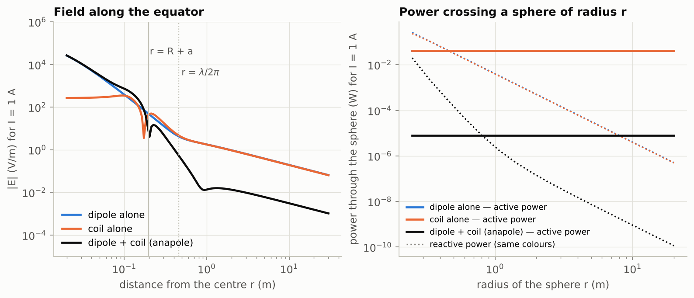
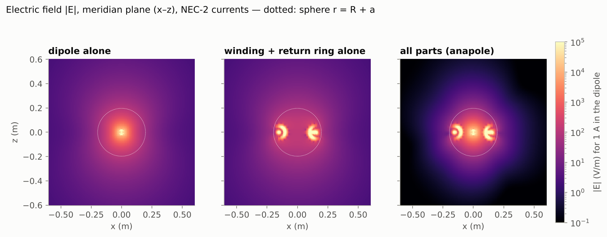

## Real currents

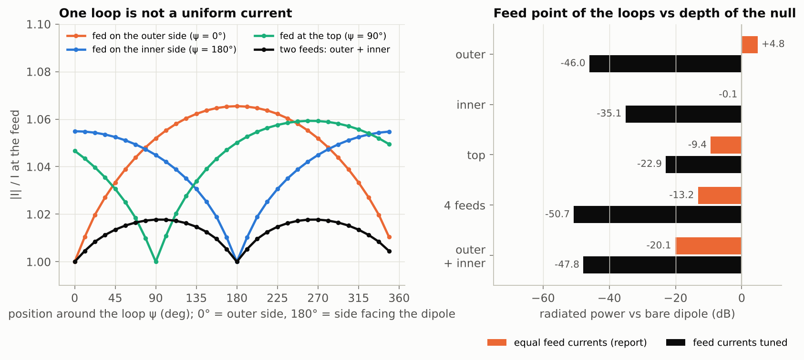
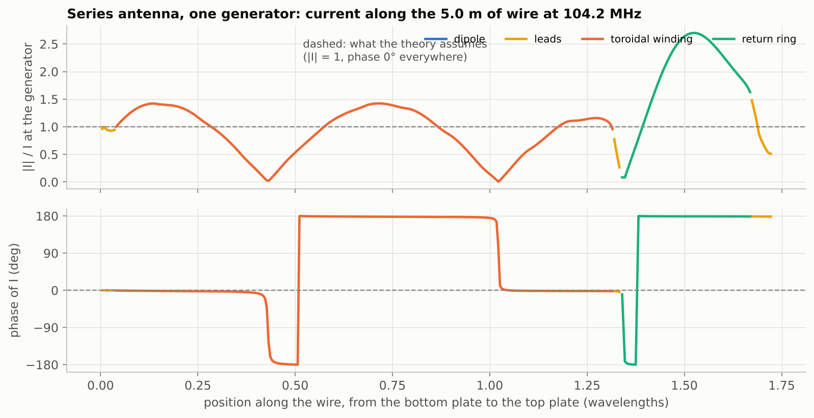
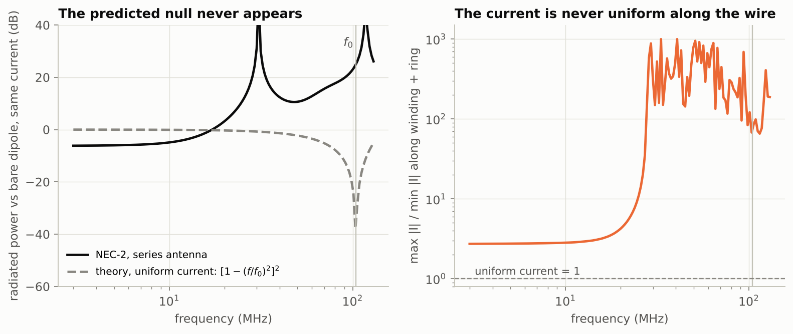
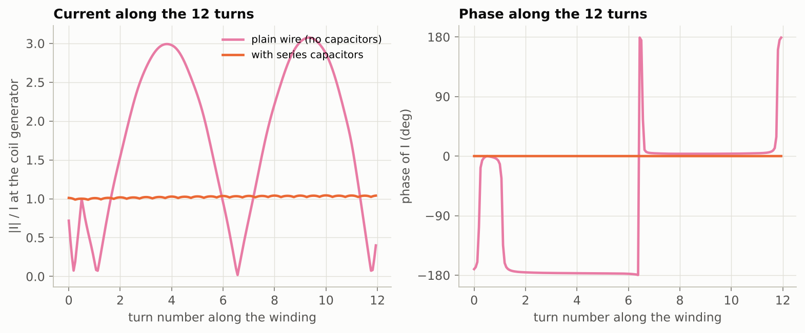
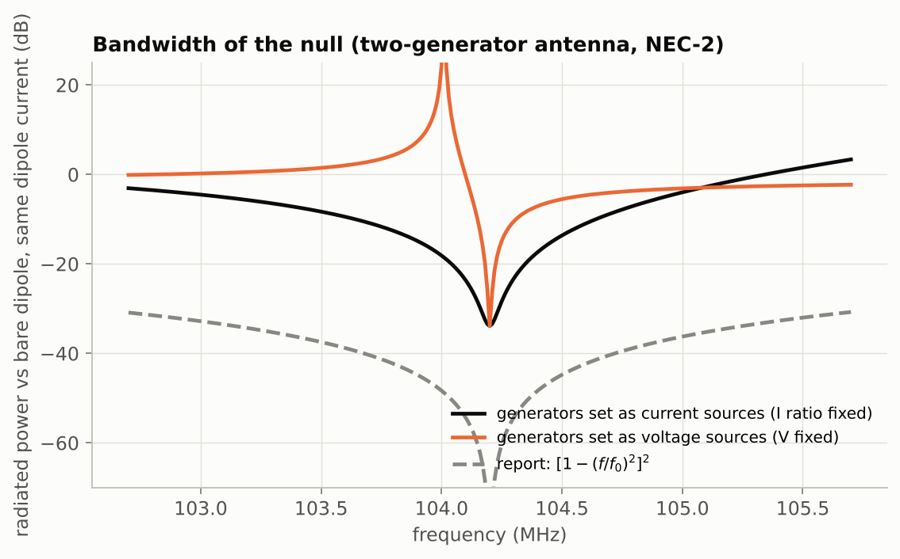

Capacitor tolerance of model 3 (40 random draws per row, no re-trimming),
median radiated power:

| Tolerance | Currents imposed | Voltage generators |
|---|---|---|
| ±0.1 % | −33.7 dB | −31.5 dB |
| ±0.5 % | −30.3 dB | −19.9 dB |
| ±1 % | −25.7 dB | −14.0 dB |
| ±2 % | −20.0 dB | −12.4 dB |
| ±5 % | −11.8 dB | −5.5 dB |

## Method

- **Model 0** (`anapole/ideal.py`): prescribed uniform currents; fields from
  the exact Hertzian-dipole expressions summed over fine current elements, no
  multipole expansion.
- **Models 1–3** (`anapole/models.py`): thin-wire models solved with NEC-2
  (necpp through PyNEC, extended thin-wire kernel). 2 mm copper wire; dipole
  with end plates made of six 30 mm radial spokes; loops and rings as
  equal-area polygons (16 sides per turn in the base mesh).
- **Per-element fields**: the segment currents returned by NEC-2 are fed to the
  same field integrator, restricted to the segments of one part.
- **Tuning**: port currents are imposed by solving the port admittance matrix;
  the current ratio that minimises the radiated power is a least-squares fit of
  the far field over the sphere.

Checks: half-wave test dipole, input power vs integrated far field within
0.03 %; far field from currents vs NEC-2 radiation pattern within 4·10⁻⁶; near
field vs NEC-2 NE/NH cards within 2–9 % in the cancelled state (28 % at one
point next to the wires); mesh convergence in `out/model1.json` and
`out/model3.json`.

Known limits: for the short thick dipole the NEC-2 input power is 4 % below
the integrated far field (source-model limit), so all powers are computed from
the currents; the tuned current ratio moves by 2–4 % with the mesh; dielectric
supports, real capacitors and feed cables are not modelled; nothing has been
built or measured.

## Files

| Path | Content |
|---|---|
| `anapole/core.py` | design constants, field integrator, NEC-2 interface, `.nec` export |
| `anapole/ideal.py` | ideal currents: dipole, loops, helix, ring |
| `anapole/models.py` | wire geometries of models 1, 2 and 3 |
| `anapole/analysis.py` | far field on the sphere, best current combination, moment tables |
| `run_model0.py` … `run_model3.py` | one script per model; numbers in `out/`, figures in `fig/` |
| `validate_nearfield.py`, `make_geometry_fig.py` | cross-check and drawing |
| `nec/*.nec` | decks for 4nec2 / xnec2c |
| `out/*.json` | every number quoted here |

## Run

```
pip install numpy scipy matplotlib PyNEC
python run_model0.py     # about 5 min
python run_model1.py     # 20 s
python run_model2.py     # 20 s
python run_model3.py     # about 25 min (python run_model3.py --plots-only reuses out/model3.json)
```
